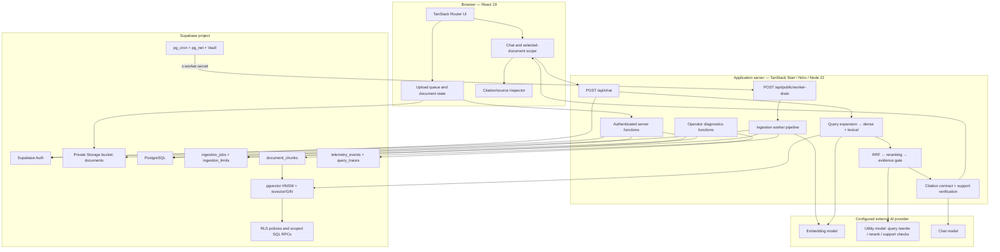

# QueryVault

QueryVault is a multi-tenant document question-answering application built with React, TanStack Start, Supabase, PostgreSQL/pgvector, and configurable AI providers. Users upload documents, wait for asynchronous indexing, select the documents in scope for a conversation, and ask questions answered from retrieved evidence with source citations.

The repository contains two distinct codebases:

- **Production application:** the repository-root TanStack Start application (`src/`, `server/`, `supabase/`).
- **Archived local reference:** `local-stack/`, a separate FastAPI + Chroma + Ollama implementation. It is not wired into the production application, its migrations, or its deployment.

> **Implementation boundary:** QueryVault includes deterministic retrieval, evidence and citation checks, and a runtime support-verification step. These controls reduce common RAG failure modes; they do not establish that every generated answer is correct or that the system is hallucination-free. The checked-in offline evaluation is a synthetic retrieval/safety regression suite, not a real-document answer-quality benchmark.

## Contents

- [Capabilities and design goals](#capabilities-and-design-goals)
- [Architecture](#architecture)
- [Request and data flows](#request-and-data-flows)
- [Repository layout](#repository-layout)
- [Technology stack](#technology-stack)
- [Authentication and security](#authentication-and-security)
- [Prerequisites](#prerequisites)
- [Local development](#local-development)
- [Zero-cost local profile](#zero-cost-local-profile)
- [Docker](#docker)
- [Environment variables](#environment-variables)
- [Database and storage setup](#database-and-storage-setup)
- [Testing, evaluation, and observability](#testing-evaluation-and-observability)
- [Operational notes](#operational-notes)
- [Architectural hygiene and cleanup recommendations](#architectural-hygiene-and-cleanup-recommendations)
- [Documentation index](#documentation-index)
- [License and attribution](#license-and-attribution)

## Capabilities and design goals

### Document ingestion

- Authenticated upload admission and owner-scoped object paths.
- Upload size limit of **25 MiB per file**.
- Supported text-bearing formats include PDF, DOCX, TXT, Markdown, CSV, HTML, XLSX, and PPTX.
- Parser-side format/signature validation, bounded Office archive inspection, text encoding checks, and extracted-content checks.
- Durable ingestion jobs stored in PostgreSQL.
- Server-authoritative parsing, chunking, embedding, and index publication. The browser cannot submit chunks, embeddings, or a `ready` state.
- Retryable job processing with lease ownership, stale-claim recovery, deterministic chunk IDs, and fenced writes.
- Duplicate detection using a SHA-256 content hash.

The upload policy also recognizes PNG/JPEG/WEBP image files, but the current parser returns `OCR_REQUIRED` for image uploads. Image OCR is not implemented in this repository. Do not describe image uploads as successfully indexed unless an OCR provider and implementation are added.

### Evidence-oriented retrieval and answers

- User-scoped document selection; the server verifies ownership and `ready` state before retrieval.
- Query expansion followed by parallel dense and lexical retrieval.
- Dense vector search using pgvector `halfvec(3072)` and an HNSW cosine index.
- PostgreSQL full-text search using `tsvector` and `ts_rank_cd` (not BM25).
- Reciprocal Rank Fusion (RRF) to combine candidate lists.
- Configurable reranking, including an LLM reranker and a deterministic heuristic fallback.
- Evidence gating before context construction.
- Evidence-only prompting with canonical source markers.
- Citation-contract validation and a runtime support-verification step before the answer is delivered.
- Grounded refusal when the retrieved evidence does not meet the configured evidence requirements.
- Request cancellation propagation and structured retrieval/answer telemetry.

### Tenant isolation and operations

- Supabase Auth for identity.
- PostgreSQL Row-Level Security (RLS) on tenant-owned tables.
- A server-only service-role client for narrowly scoped server-authoritative writes.
- Rate limiting and atomic ingestion admission in PostgreSQL.
- A protected worker-drain endpoint.
- Operator-only diagnostics at `/admin`, including metrics, query traces, event data, and the `TraceWaterfall` visualization.

## Architecture



The diagram is a logical view. The ingestion worker executes inside the Node application process when invoked by the worker-drain route or by the optional dedicated worker script. Supabase supplies authentication, database, private object storage, and the scheduled trigger; it does not host the application server.

## Request and data flows

### Ingestion pipeline

1. The authenticated client calculates the file hash and calls the document-upload server function.
2. The server validates filename, extension/MIME compatibility, byte size, and per-user rate limits. It checks for an existing content hash.
3. A server-authoritative document reservation is created. The object path is owner-scoped (`<user-id>/<document-id>.<extension>`), and a signed upload URL is requested from the private `documents` bucket.
4. The browser uploads the original object. It then asks the server to enqueue ingestion; the browser cannot create chunks or mark the document ready.
5. The worker claims a queued/retryable job through the database claim function. Claiming uses row locking with `FOR UPDATE SKIP LOCKED`, lease ownership, and attempt fencing to prevent two workers from processing the same job concurrently.
6. The worker downloads the stored object, checks its actual bytes and metadata, parses it, extracts pages/slides/sheets, and creates versioned chunks.
7. The worker requests embeddings from the selected AI provider and writes chunk rows through the claim-fenced database mutation function.
8. The database checks that the expected chunk set, embedding model, dimension, and chunking version are complete before publishing the document as `ready`.
9. Failed work is classified as retryable or permanent and recorded in the job/document state. Deterministic IDs and upserts make retries idempotent.

The database migration schedules `POST /api/public/worker-drain` once per minute using `pg_cron`/`pg_net`. The scheduled function reads the endpoint URL and shared secret from Supabase Vault at execution time. The application can also run a continuously polling worker with `npm run worker` when that deployment topology is chosen.

### Retrieval, generation, and citation verification

1. `POST /api/chat` requires a bearer access token. The route verifies the caller against Supabase Auth and obtains an RLS-scoped Supabase client.
2. The route validates the request, enforces chat rate limits, confirms that the thread belongs to the caller, and validates that every explicitly selected document is owned by the caller and is queryable.
3. Query expansion produces one or more query variants.
4. Dense and lexical retrieval execute in parallel. Both database search functions scope results to the authenticated user and optional selected document IDs, and only include ready/currently indexed documents.
5. RRF combines the dense and lexical candidate rankings. The configured reranker reorders the fused candidates; if the LLM reranker fails or times out, the pipeline can use its configured deterministic fallback.
6. The evidence gate decides whether the retrieved passages meet the configured grounding requirements. If not, the route returns the grounded refusal rather than asking the model to answer from absent evidence.
7. For grounded queries, the context builder deduplicates and budgets evidence, then assigns source IDs.
8. The chat model produces a candidate answer under an evidence-only prompt. The server validates citation markers and block-level citation requirements, then invokes the runtime support verifier where required.
9. The server streams the accepted answer or a grounded refusal and records privacy-conscious telemetry. Request cancellation is propagated rather than silently converted into an answer.

**Retrieval terminology:** lexical search is PostgreSQL full-text search (`websearch_to_tsquery` / `ts_rank_cd` against `content_tsv`); it is not a BM25 implementation. Dense search calls `match_document_chunks_v2`; lexical search calls `lexical_document_chunks`.

## Repository layout

```text
.
├── src/
│   ├── components/          # React UI, AI message elements, landing and admin UI
│   ├── hooks/               # Client hooks, including Supabase auth state
│   ├── integrations/
│   │   └── supabase/        # Browser/server clients, auth middleware, token verification
│   ├── lib/
│   │   ├── ingestion/       # Parser, archive policy, leases, worker stages/contracts
│   │   ├── retrieval/       # Dense/lexical search, RRF, reranking, evidence/citation checks
│   │   ├── observability/   # Events, health, telemetry, operator metrics, trace privacy
│   │   └── __tests__/       # Vitest unit and integration tests
│   ├── routes/              # TanStack file routes and API handlers
│   ├── router.tsx           # Router setup
│   ├── routeTree.gen.ts     # Generated route tree; do not edit manually
│   ├── server.ts            # Server entry
│   └── start.ts             # TanStack Start entry
├── server/
│   └── plugins/             # Nitro startup configuration guard
├── supabase/
│   ├── migrations/          # Ordered schema, RLS, RPC, storage, worker and hardening migrations
│   ├── templates/           # Supabase Auth email templates
│   ├── bootstrap.sql        # Bootstrap SQL helper
│   └── config.toml          # Supabase local project configuration
├── scripts/                 # Worker, reindex, DB test, benchmark, local/dev utilities
├── config/                  # Zero-cost local environment template
├── e2e/                     # Playwright browser specifications
├── evaluation/
│   ├── benchmark/           # Separate real-document benchmark framework and templates
│   ├── fixtures.ts          # Synthetic retrieval fixture corpus
│   ├── dataset.ts           # Synthetic evaluation questions/labels
│   ├── runner.ts            # Offline retrieval regression runner
│   ├── safety.ts            # Deterministic safety contract checks
│   └── thresholds.json      # Evaluation gate thresholds
├── demo/                    # Demonstration material and sample documents
├── docs/                    # Architecture, deployment, security, testing and phase notes
├── local-stack/             # Archived FastAPI + Chroma + Ollama reference application
├── public/                  # Static public assets
├── Dockerfile               # Multi-stage Node 22 production image
├── docker-compose.yml       # Local production-image verification harness
├── package.json             # Scripts and direct dependency specifications
├── package-lock.json        # npm lockfile (lockfileVersion 3)
├── bun.lock                 # Bun lockfile used by Docker dependency stage
└── LICENSE                  # MIT License; copyright 2025 Darsh Soam
```

### Important routes and modules

| Path | Responsibility |
|---|---|
| `src/routes/api/chat.ts` | Authenticated chat, document-scope validation, retrieval, generation, answer validation and streaming |
| `src/routes/api/public/worker-drain.ts` | Shared-secret-protected ingestion drain endpoint |
| `src/routes/api/public/health.ts` | Public health/readiness probes |
| `src/routes/admin.tsx` | Operator diagnostics UI |
| `src/lib/documents.functions.ts` | Authenticated upload reservation, enqueue, status and document operations |
| `src/lib/ingestion/worker.server.ts` | Server-authoritative ingestion worker |
| `src/lib/retrieval/pipeline.ts` | Query expansion, parallel retrieval, RRF, reranking, evidence gate and context |
| `src/lib/retrieval/citation-validator.ts` | Deterministic citation-contract checks |
| `src/lib/retrieval/support-verifier.server.ts` | Runtime semantic support verification |
| `src/integrations/supabase/verify-token.server.ts` | Supabase Auth-backed bearer-token verification for API routes |
| `server/plugins/config-guard.ts` | Fail-fast server configuration validation |

## Technology stack

Versions below distinguish the **declared manifest range** from the **npm lockfile resolution**. The lockfile resolution is the concrete version selected by the checked-in `package-lock.json`; `package.json` may intentionally use a semver range.

### Production dependencies

| Area | Package | `package.json` spec | `package-lock.json` resolved |
|---|---|---:|---:|
| UI | `react`, `react-dom` | `^19.2.0` | `19.2.8` |
| Full-stack framework | `@tanstack/react-start` | `1.168.32` | `1.168.32` |
| Routing | `@tanstack/react-router` | `1.170.18` | `1.170.18` |
| Client data | `@tanstack/react-query` | `^5.101.1` | `5.101.4` |
| AI SDK | `ai` | `^7.0.64` | `7.0.64` |
| AI provider adapter | `@ai-sdk/google` | `^4.0.93` | `4.0.93` |
| AI provider adapter | `@ai-sdk/openai-compatible` | `^3.0.30` | `3.0.30` |
| Supabase | `@supabase/supabase-js` | `^2.112.3` | `2.112.3` |
| Styling | `tailwindcss` | `^4.2.1` | `4.3.3` |
| Vite integration | `@tailwindcss/vite` | `^4.2.1` | `4.3.3` |
| Markdown/AI UI | `streamdown` | `^2.5.0` | `2.7.0` |
| Markdown plugins | `@streamdown/cjk`, `@streamdown/code`, `@streamdown/math`, `@streamdown/mermaid` | `^1.0.3`, `^1.1.1`, `^1.0.2`, `^1.0.2` | `1.0.3`, `1.1.1`, `1.0.3`, `1.0.3` |
| Document parsing | `unpdf` | `^1.8.0` | `1.8.0` |
| Office parsing | `mammoth` | `^1.10.0` | `1.13.0` |
| Spreadsheet parsing | `xlsx` | SheetJS CDN tarball `0.20.3` | `0.20.3` |
| Office archive inspection | `jszip` | `^3.10.1` | `3.10.2` |
| Validation | `zod` | `^3.24.2` | `3.25.76` |
| UI primitives | `@radix-ui/*` | See `package.json` | See `package-lock.json` |
| Animation | `gsap`, `motion`, `lenis` | `^3.15.0`, `^13.1.0`, `^1.3.26` | `3.15.0`, `13.1.0`, `1.3.26` |
| Utility/UI | `lucide-react`, `sonner`, `clsx`, `tailwind-merge`, `class-variance-authority` | See `package.json` | See `package-lock.json` |

The app's AI provider resolver supports `openai`, `gemini`, `lovable`, and `openai-compatible`. The SDK adapters in the manifest are Google and OpenAI-compatible; the OpenAI and Lovable provider integrations use compatible provider protocols configured by the server gateway.

### Development and quality dependencies

| Area | Package | Declared spec | Locked version |
|---|---|---:|---:|
| Build/dev server | `vite` | `^8.2.0` | `8.2.0` |
| TypeScript | `typescript` | `^5.8.3` | `5.9.3` |
| Node types | `@types/node` | `^22.16.5` | `22.20.1` |
| Nitro | `nitro` | `3.0.260603-beta` | `3.0.260603-beta` |
| TanStack Vite config | `@lovable.dev/vite-tanstack-config` | `2.13.1` | `2.13.1` |
| ESLint | `eslint` | `^9.32.0` | `9.39.5` |
| TypeScript ESLint | `typescript-eslint` | `^8.56.1` | `8.65.0` |
| Prettier | `prettier` | `^3.7.3` | `3.9.6` |
| Unit/integration tests | `vitest` | `^4.1.10` | `4.1.10` |
| Coverage | `@vitest/coverage-v8` | `^4.1.10` | `4.1.10` |
| DOM test environment | `jsdom` | `^30.0.1` | `30.0.1` |
| React Testing Library | `@testing-library/react` | `^16.3.2` | `16.3.2` |
| DOM Testing Library | `@testing-library/dom` | `^10.4.2` | `10.4.2` |
| Browser E2E | `@playwright/test` | `^1.64.0` | `1.64.0` |
| Environment portability | `cross-env` | `^7.0.3` | `7.0.3` |

`knip.json` is present as a Knip configuration file, but **Knip is not declared in `package.json` and there is no Knip npm script**. Do not assume `npx knip` is part of the installed project toolchain. `depcheck` is also not declared.

### Runtime and data services

| Component | Role |
|---|---|
| Node.js 22 | Application build/runtime target; the production container uses `node:22-bookworm-slim` |
| Bun 1.2 | Dependency installation in the Docker build and execution of selected evaluation/worker scripts |
| TanStack Start + TanStack Router | SSR application, typed routing and server functions |
| Nitro | Node server output (`.output/server/index.mjs`) |
| Supabase Auth | User authentication and access-token validation |
| Supabase Storage | Private original-document storage |
| PostgreSQL | Durable metadata, ingestion queue, messages, telemetry and policy enforcement |
| pgvector | Dense vector similarity search using `halfvec(3072)` |
| PostgreSQL FTS | Lexical search using stored `tsvector` and GIN indexing |
| pg_cron + pg_net + Vault | Scheduled authenticated worker-drain trigger |

## Authentication and security

### User authentication

- The browser authenticates through Supabase Auth. Email/password is configured in `supabase/config.toml`; Google OAuth is an optional provider controlled by `VITE_ENABLE_GOOGLE_AUTH`.
- Authenticated TanStack server functions use `requireSupabaseAuth`, which requires a bearer token, performs structural checks, and validates JWT claims with Supabase Auth `getClaims`.
- `POST /api/chat` uses `verifyAccessToken`, which calls `auth.getUser(token)` and rejects invalid, expired, deleted, or otherwise unavailable users.
- User-scoped Supabase clients use the publishable key plus the caller's bearer token. They are subject to RLS.

### Authorization and tenant isolation

- Core tenant tables such as `profiles`, `documents`, `document_chunks`, `threads`, and `messages` have RLS enabled with `auth.uid()` ownership policies.
- Additional tables for roles, traces, telemetry, jobs, rate limits, and ingestion admission also have RLS or server-only grants/policies as defined in the migrations.
- Retrieval RPCs explicitly require `auth.uid() = requesting_user_id`, match chunk/document ownership, require `ready` documents, and honor selected document IDs.
- The service-role key bypasses RLS. It is confined to server-side modules for operations that require elevated authority, such as worker writes and document reservation operations. Never pass it to browser code.
- `/admin` is not granted to every signed-in user. Both the UI and each diagnostics server function check for `admin` or `operator` in `user_roles`.

### Worker endpoint

`POST /api/public/worker-drain` accepts only the `x-worker-secret` header. The value is compared with `INGESTION_WORKER_SECRET` using the constant-time comparison helper. A missing or incorrect secret returns `401`; there is no bearer-token fallback. The Supabase scheduler stores the endpoint URL and matching secret in Vault and sends the header through `pg_net`.

### Upload validation and storage

- The `documents` Storage bucket is private and owner-scoped.
- The upload limit is 25 MiB; the server rechecks stored object metadata and bytes.
- File extension and MIME compatibility are validated; browser MIME values are not treated as proof of file contents.
- PDF parsing checks the `%PDF-` signature. DOCX/XLSX/PPTX archives are inspected for expected entries, unsafe paths, encrypted entries, entry counts, expanded-size limits, and compression-ratio limits.
- Text input is checked for binary bytes and valid UTF-8. Empty or unusable extracted content fails ingestion.
- There is **no separate quarantine bucket or malware-scanning service** in the inspected code. Invalid files are rejected or moved to a failed ingestion state; do not describe this as antivirus quarantine.
- Images are accepted by the upload policy but cannot currently be OCR-processed by the parser.

### Secret handling

- `VITE_*` variables are public and inlined into the client bundle at build time. They must never contain secrets.
- Server secrets are runtime environment variables. Do not add `VITE_` to their names.
- The build config rejects missing/placeholder public Supabase configuration unless the explicit throwaway-build override is set; it never permits a service-role secret in public variables.
- A Nitro startup plugin validates server configuration before the server begins accepting requests.
- `npm run security:client` checks built client output for configured secret material.

## Prerequisites

For the root application:

- Node.js **22**.
- npm (ships with Node.js).
- Bun **1.2+** for scripts that explicitly invoke `bun`, including `eval`, `eval:gate`, `worker`, and benchmark scripts.
- A Supabase project with Auth, PostgreSQL, pgvector, and Storage enabled.
- Supabase CLI for local Supabase development and applying migrations.
- Docker Engine/Desktop only if using Supabase local services, database tests, or the production-image Compose harness.
- A supported AI provider credential for live ingestion embeddings and chat. The zero-cost local profile intentionally disables AI requests.

The repository does not define a Node `engines` field. Node 22 is the runtime verified and used by the supplied production Dockerfile.

## Local development

### 1. Clone and install

No repository remote or active branch is encoded in the source archive in a way that can be independently verified. Use the clone URL supplied by your repository host; do not rely on the historical clone URL or branch command in the previous README.

```bash
git clone <your-repository-url> QueryVault-Project
cd QueryVault-Project

# npm workflow
npm ci
```

The Docker dependency stage instead uses the checked-in `bun.lock`:

```bash
bun install --frozen-lockfile
```

Do not mix package managers in the same install directory. Choose npm (`package-lock.json`) or Bun (`bun.lock`) for a given working tree.

### 2. Configure environment

```bash
cp .env.example .env
```

Set the public and server-side Supabase values to the **same project**. Configure a provider key if you want live embedding and chat. See [Environment variables](#environment-variables).

`VITE_*` values are compiled into the browser bundle, so changing them requires restarting Vite in development and rebuilding the artifact for production.

### 3. Apply database migrations

Link the Supabase CLI to the intended project and apply the ordered migrations:

```bash
supabase login
supabase link --project-ref <your-project-ref>
supabase db push
```

For a local Supabase stack, start it and apply the migrations to that local instance:

```bash
supabase start
supabase db reset
```

Review the migration output before using the application. The migration set creates the schema, RLS policies, RPCs, private Storage bucket, ingestion scheduler, and supporting indexes. Configure the Supabase Vault entries required by the worker scheduler as described in [Deployment](docs/DEPLOYMENT.md).

### 4. Start the application

```bash
npm run dev
```

Vite normally serves the application at `http://localhost:5173`. Check the terminal for the actual URL if the port is occupied.

For a production-like local Node build:

```bash
npm run build:node
npm run start
```

The production output is `.output/server/index.mjs`, served on port `3000` by default.

## Zero-cost local profile

`QV_LOCAL_ONLY` is an explicit local-only guard. It is **not** a self-contained offline database mode: it requires a local Supabase instance and disables external AI requests. It also rejects remote Supabase URLs.

1. Start local Supabase and apply migrations.
2. Copy `config/zero-cost.env.example` to `.env.zero-cost.local`.
3. Replace the placeholders with keys generated by the **local** Supabase stack. Never place hosted credentials in this file.
4. Run:

```bash
npm run dev:zero-cost
```

The script reads only `.env.zero-cost.local`, requires loopback HTTP Supabase URLs, sets `QV_LOCAL_ONLY=1` and `VITE_QV_LOCAL_ONLY=1`, empties inherited AI provider keys, and starts Vite bound to `127.0.0.1:5173`. AI inference and embedding requests are blocked in this profile.

## Docker

The root `Dockerfile` builds a three-stage image:

1. Node 22 + Bun 1.2 install stage (`bun install --frozen-lockfile`).
2. Node 22 build stage running `npm run build:node` with Nitro's `node-server` preset.
3. Node 22 slim runtime containing only `.output`, running as the unprivileged `node` user.

The image exposes port `3000`, uses a read-only root filesystem in Compose, drops Linux capabilities, sets `no-new-privileges`, and includes a Node-fetch health check against `/api/public/health?probe=live`.

### Compose verification harness

```bash
cp .env.docker.example .env.docker
# Fill in valid values in .env.docker; do not commit it.
docker compose --env-file .env.docker up --build
```

Open `http://localhost:3000`.

The image is environment-specific for browser-safe `VITE_*` build-time values. Server secrets are injected at runtime, not Docker build arguments. The Compose file forwards provider keys for OpenAI, Gemini, Lovable, and OpenAI-compatible providers; add `GEMINI_API_KEY` to `.env.docker` manually if selecting Gemini because it is not currently listed in `.env.docker.example`.

For a manual image build, the Dockerfile's public build arguments are `VITE_SUPABASE_URL`, `VITE_SUPABASE_PUBLISHABLE_KEY`, `VITE_SUPABASE_PROJECT_ID`, and `VITE_APP_URL`. The Compose build section currently forwards the first three but omits `VITE_APP_URL`; see the cleanup notes below.

## Environment variables

The committed `.env.example` and `.env.docker.example` are the environment contracts. Never commit real `.env` files. Required values must refer to one Supabase project.

### Supabase and browser configuration

| Variable | Required | Scope | Purpose |
|---|---|---|---|
| `VITE_SUPABASE_URL` | Yes | Public/build time | Supabase URL embedded in browser bundle |
| `VITE_SUPABASE_PUBLISHABLE_KEY` | Yes | Public/build time | Supabase publishable/anon key; safe only with RLS |
| `VITE_SUPABASE_PROJECT_ID` | Yes | Public/build time | Project identity cross-check |
| `VITE_APP_URL` | Production recommended/required | Public/build time | Canonical auth email/OAuth redirect URL; falls back to browser origin when empty in development |
| `VITE_ENABLE_GOOGLE_AUTH` | Optional, default `false` | Public/build time | Shows Google sign-in only when configured in Supabase |
| `SUPABASE_URL` | Yes | Server runtime | Same project URL as `VITE_SUPABASE_URL` |
| `SUPABASE_PUBLISHABLE_KEY` | Yes | Server runtime | Same publishable key as browser config, used for RLS-scoped clients |
| `SUPABASE_PROJECT_ID` | Yes | Server runtime | Project identity cross-check |
| `SUPABASE_SERVICE_ROLE_KEY` | Yes for normal server operation | Server secret | RLS-bypassing key for server-authoritative operations; never expose |
| `INGESTION_WORKER_SECRET` | Required to enable worker endpoint | Server secret | Shared secret for `x-worker-secret` authorization; missing value keeps worker drain unauthorized |

### AI provider configuration

| Variable | Required | Scope | Purpose |
|---|---|---|---|
| `AI_PROVIDER` | Optional if inferred; recommended explicit | Server runtime | `openai`, `gemini`, `lovable`, or `openai-compatible` |
| `OPENAI_API_KEY` | If `AI_PROVIDER=openai` | Server secret | OpenAI credential |
| `GEMINI_API_KEY` | If `AI_PROVIDER=gemini` | Server secret | Google Gemini credential |
| `LOVABLE_API_KEY` | If `AI_PROVIDER=lovable` | Server secret | Lovable AI Gateway credential |
| `AI_API_KEY` | If `AI_PROVIDER=openai-compatible` | Server secret | Credential for compatible endpoint |
| `AI_BASE_URL` | Required for `openai-compatible`; optional override otherwise | Server runtime | Provider base URL |
| `AI_CHAT_MODEL` | Required for `openai-compatible`; optional override otherwise | Server runtime | Chat model |
| `AI_UTILITY_MODEL` | Optional | Server runtime | Query rewrite/reranking/support-verification model |
| `AI_EMBEDDING_MODEL` | Required for `openai-compatible`; optional override otherwise | Server runtime | Embedding model |
| `AI_EMBEDDING_DIMENSIONS` | Optional; must equal `3072` | Server runtime | Embedding dimension; must match `halfvec(3072)` |
| `OPENAI_BASE_URL`, `OPENAI_CHAT_MODEL`, `OPENAI_UTILITY_MODEL`, `OPENAI_EMBEDDING_MODEL` | Optional | Server runtime | OpenAI-specific overrides |
| `GEMINI_BASE_URL`, `GEMINI_CHAT_MODEL`, `GEMINI_UTILITY_MODEL`, `GEMINI_EMBEDDING_MODEL` | Optional | Server runtime | Gemini-specific overrides |

Provider defaults defined by `src/lib/ai-gateway.server.ts`:

| Provider | Chat default | Utility default | Embedding default |
|---|---|---|---|
| `openai` | `gpt-4o` | `gpt-4o-mini` | `text-embedding-3-large` |
| `gemini` | `gemini-3.8-flash` | `gemini-3.8-flash` | `gemini-embedding-001` |
| `lovable` | `google/gemini-3.6-flash` | `google/gemini-3.6-flash` | `google/gemini-embedding-2` |
| `openai-compatible` | No default | Falls back to configured chat model | No default |

All configured embedding models must return **3072 dimensions** unless the database schema is deliberately migrated. Provider/model identifiers are code defaults, not a guarantee that a remote provider account currently exposes a model.

### Runtime, limits, and optional controls

| Variable | Required | Default / allowed values | Purpose |
|---|---|---|---|
| `HOST` | No | `0.0.0.0` in Docker | Bind host |
| `PORT` | No | `3000` | HTTP port |
| `QV_RELEASE` | No | `local` | Release/image identifier surfaced in health and telemetry |
| `QV_RATE_CHAT_PER_MIN` | No | `30` | Chat requests per user per minute |
| `QV_RATE_EMBED_PER_MIN` | No | `120` | Embedding calls per user per minute |
| `QV_RATE_UPLOAD_PER_5MIN` | No | `20` | Uploads per user per five minutes |
| `QV_RATE_CLIENT_ERROR_PER_5MIN` | No | `20` | Client error reports per user per five minutes |
| `INGESTION_WORKER_CONCURRENCY` | No | `3` (worker script clamps to 1–5) | Dedicated polling worker concurrency |
| `QV_EMBED_CONCURRENCY` | No | `2` | Per-process embedding HTTP concurrency |
| `QV_TRACE_CONTENT` | No | `0` / off | Enables private trace text; requires explicit operator approval and retention/access controls |
| `QV_E2E_ISOLATED` | No | unset | Attests that database-writing E2E tests target an isolated Supabase project |
| `RUN_LIVE_GEMINI_TESTS` | No | unset | Opt-in synthetic-only Gemini provider tests |
| `QV_CONFIRMED_FREE_TIER` | No | unset | Explicit operator attestation required by live test safeguards |
| `QV_ALLOW_PLACEHOLDER_CONFIG` | No | Build-only `1` | Allows a throwaway build with placeholder public config; never deploy that artifact |
| `QV_LOCAL_ONLY` | No | `1` to enable | Server-side local-only guard; requires loopback Supabase and disables AI requests |
| `VITE_QV_LOCAL_ONLY` | No | `1` to enable | Browser/build counterpart to local-only guard |
| `VITE_UPLOAD_BATCH_COUNT` | No | `20` | Build-time UI batch count limit |
| `VITE_UPLOAD_BATCH_BYTES` | No | `209715200` | Build-time UI batch byte limit |
| `VITE_MAX_DOCUMENT_SELECTION` | No | `100` | Build-time document selection cap |
| `QV_BROWSER_CHANNEL` | No | Playwright default | Optional Playwright browser channel |
| `PLAYWRIGHT_BASE_URL` | No | `http://127.0.0.1:5173` | Playwright app base URL; must be loopback HTTP |
| `QV_E2E_PREBUILT` | No | `1` to use prebuilt server | Playwright webServer mode |
| `QV_E2E_COLD_START` | No | `1` to force Vite | Playwright dev-server cold start |
| `QV_DB_TEST_CONTAINER` | For DB test | `queryvault-phase2-*` naming contract | Explicit disposable PostgreSQL/pgvector test container selector |
| `QV_VERIFY_WITHOUT_DOTENV` | No | `1` | Prevents Vite from loading `.env` for isolated verification workflows |

The database table `public.ingestion_limits` controls atomic admission defaults (20 pending files per user, 200 MiB pending bytes per user, and 3 global workers). These limits are database configuration, not environment variables. Rate limiting is fail-closed if the limiter cannot access its backing table.

`QV_LOCAL_ONLY=1` and `VITE_QV_LOCAL_ONLY=1` are not general production flags. The zero-cost launcher sets them and empties AI keys automatically.

## Database and storage setup

The ordered SQL migrations are under `supabase/migrations/`. They create and evolve:

- `profiles`, `documents`, `document_chunks`, `threads`, and `messages`.
- `ingestion_jobs`, worker credential/admission support, and atomic upload admission.
- `user_roles`, `telemetry_events`, and `query_traces`.
- IP/user rate-limit structures and operational functions.
- Dense retrieval RPCs (`match_document_chunks_v2`) and lexical retrieval (`lexical_document_chunks`).
- Claiming and fenced mutation RPCs for ingestion.
- The private `documents` Storage bucket and owner-scoped object policies.
- The scheduled worker trigger and health/observability functions.

The `documents` bucket is private. Its final allowed MIME types and extension policies cover PDF, DOCX, TXT, Markdown, CSV, HTML, XLSX, PPTX, PNG, JPEG, and WEBP. The actual parser support is narrower for images because OCR is not implemented.

The core vector column is `halfvec(3072)` and uses an HNSW cosine index. Lexical search uses a generated/stored `content_tsv` and GIN indexing. The migration `20260822000000_drop_redundant_fts_index.sql` removes a redundant expression index after the stored `tsvector` was introduced.

For detailed setup, including Supabase Auth redirect URLs, Vault secrets, scheduler configuration, migrations, and rollback, see [docs/DEPLOYMENT.md](docs/DEPLOYMENT.md) and [supabase/STORAGE.md](supabase/STORAGE.md). Note that `supabase/STORAGE.md` still describes the original PDF-only policy; the later `20261008000000_expand_document_formats.sql` migration broadens the actual bucket policy.

## Testing, evaluation, and observability

### Project scripts

| Command | What it runs |
|---|---|
| `npm run typecheck` | TypeScript check (`tsc --noEmit`) |
| `npm run lint` | ESLint over the repository |
| `npm test` | Vitest unit/component/integration tests, excluding `e2e` |
| `npm run test:e2e` | Playwright browser suite |
| `npm run test:db` | Disposable PostgreSQL/pgvector database test script |
| `npm run eval` | Synthetic offline retrieval evaluation runner |
| `npm run eval:gate` | Retrieval evaluation gate followed by deterministic safety checks |
| `npm run eval:safety` | Deterministic safety contract checks |
| `npm run benchmark` | Real-document benchmark CLI (`bun --no-env-file evaluation/benchmark/main.ts`) |
| `npm run benchmark:ingestion` | Ingestion benchmark script |
| `npm run demo:rehearse` | Automated demo rehearsal script |
| `npm run reindex` | Reindex utility |
| `npm run worker` | Dedicated continuously polling ingestion worker |
| `npm run security:client` | Client-bundle secret scan |
| `npm run dev:zero-cost` | Loopback-only local profile with AI calls disabled |
| `npm run build` | Standard Vite/Nitro build |
| `npm run build:node` | Build using Nitro `node-server` preset |
| `npm run start` | Start `.output/server/index.mjs` |

The evaluation, worker, and ingestion benchmark scripts invoke Bun internally. Install Bun before running those commands.

### Unit and integration tests

```bash
npm test
npm run typecheck
npm run lint
```

Tests cover configuration, auth, upload policy/queue, parsing limits, chunking, ingestion leases/retries, worker concurrency, retrieval, citation validation, support verification, rate limiting, cancellation, UI components, and route behavior.

Do not infer a current pass count from historical documentation. Run the suite in the target environment and use its actual summary.

### Playwright E2E

```bash
npm run test:e2e
```

The Playwright config starts the Vite dev server on loopback by default and sets local-only safeguards, including clearing external AI credentials. It uses Chromium. Database-writing tests require an explicitly isolated local Supabase project and `QV_E2E_ISOLATED=1`; never point them at production credentials. Inspect skipped tests and startup output when interpreting a run.

### RAG evaluation gates

```bash
npm run eval
npm run eval:gate
```

The checked-in offline dataset has **13 synthetic questions over 15 synthetic chunks**. The runner substitutes hand-authored topic vectors and lexical overlap for real retrievers, then exercises production fusion, heuristic reranking, evidence gating, and context construction. The gate validates retrieval-oriented metrics and deterministic safety contracts.

It does **not** measure real embedding retrieval, generated answer correctness, semantic faithfulness, model resistance to prompt injection, generated citation support, or generation-stage refusal accuracy. These are not production accuracy scores.

The separate real-document benchmark framework under `evaluation/benchmark/` is implemented, but its checked-in manifest is currently empty (`population-pending`). The sample documents/questions are synthetic and unreviewed. A reviewed 60-question corpus, live benchmark, and human answer review have not been completed in the checked-in state. See [docs/REAL_DOCUMENT_BENCHMARK.md](docs/REAL_DOCUMENT_BENCHMARK.md).

### Database test

```bash
npm run test:db
```

This script requires Docker and an explicitly named disposable PostgreSQL/pgvector test container via `QV_DB_TEST_CONTAINER`. It is not a test against the deployed Supabase project. See [docs/TESTING.md](docs/TESTING.md).

### Static analysis and bundle checks

```bash
npm run typecheck
npm run lint
npm run security:client
```

`knip.json` exists, but Knip is not currently installed or exposed as an npm script. Add it as a dev dependency and a script before treating Knip as an executable quality gate. No `depcheck` dependency or script is present.

### Observability dashboard

Open `/admin` while signed in as a user whose `user_roles` row has role `operator` or `admin`. The UI and server functions independently enforce this role check.

The dashboard includes:

- API request/error rates and latency percentiles.
- Retrieval and generation latency and grounded/refusal metrics.
- Ingestion queue counts, retries, failures, and durations.
- Query traces with retrieval stages, citations, reranker fallback information, and per-stage timings.
- Recent telemetry events.

Trace content is privacy-sensitive and disabled by default. `QV_TRACE_CONTENT=1` should only be enabled with explicit operator approval, access controls, and a retention policy.

## Operational notes

- The Node app is stateful only for in-flight work; durable documents, jobs, vectors, messages, and telemetry live in Supabase.
- Use a long-running Node process for the integrated worker-drain topology. Serverless hosting needs a separate always-on worker if parsing/embedding may exceed function execution limits.
- The container uses Node 22, a non-root runtime user, read-only filesystem, dropped capabilities, and a 30-second shutdown grace period in Compose.
- The health route supports public health/liveness probes. The deep worker health probe requires the worker secret.
- AI provider absence is handled as a configuration condition: the UI/server can start, but chat and embedding-dependent ingestion cannot complete successfully without a valid provider configuration.

## Architectural hygiene and cleanup recommendations

These are repository observations and recommended follow-ups, not claims that the current application is broken.

1. **Choose and document one default package manager.** Both `package-lock.json` (npm lockfile v3) and `bun.lock` (Bun lockfile v1) are committed. The native quickstart can use `npm ci`; the Docker dependency stage uses `bun install --frozen-lockfile`. The two lockfiles are not identical: the Bun lock includes packages not present in the root `package.json` dependency set. Decide whether both workflows are intentional, keep them synchronized, and add CI checks that detect drift.
2. **Reconcile Docker Compose build args.** `Dockerfile` declares `VITE_APP_URL`, but `docker-compose.yml` does not forward it under `build.args`. Add it if Compose builds need canonical auth redirect URLs.
3. **Complete the Docker Gemini template.** `docker-compose.yml` forwards `GEMINI_API_KEY`, but `.env.docker.example` does not list it. Add it to the template or remove the mapping if Gemini is intentionally excluded from that template.
4. **Remove or ignore generated/local artifacts.** `test-results/.last-run.json` is present in the archive; it is a Playwright run artifact and should generally be ignored rather than committed. `supabase/.temp/cli-latest` is also a local CLI artifact; ensure `supabase/.temp/` is ignored. `src/routeTree.gen.ts` is generated and should be regenerated by the router tooling, not manually maintained.
5. **Resolve unused-tool configuration.** `knip.json` references Knip's schema, but Knip is not in `package.json`; there is no Knip script. Add the tool and a script if it is part of the intended quality process, otherwise remove the unused config. `depcheck` is not installed.
6. **Correct stale documentation.** The previous README referred to a historical branch, older Gemini model names, BM25, a 3-slot client upload queue as a universal concurrency guarantee, and an image quarantine behavior not present in the implementation. `supabase/STORAGE.md` still documents PDF-only bucket policy even though later migrations expand formats. Update those docs to match the final migrations and current code.
7. **Clarify image support.** The upload policy accepts PNG/JPEG/WEBP, while the parser currently fails image files with `OCR_REQUIRED`. Either implement and test OCR or label images as accepted-but-not-processable until OCR is configured.
8. **Review archived reference code.** `local-stack/` is a separate FastAPI/Chroma/Ollama app and is not part of the production runtime. Keep it clearly labelled as reference material or move it to a separate repository if it is no longer maintained.
9. **Avoid overstating evaluation.** The offline gate uses synthetic fixtures and does not score generated answer quality. The real-document benchmark manifest is empty. Keep benchmark readiness and production answer-quality claims separate from unit-test success.
10. **Verify repository identity before publishing clone commands.** The source archive does not provide a verifiable Git remote or active branch. Replace `<your-repository-url>` in this README with the canonical repository URL when confirmed; do not restore an unverified historical branch checkout command.

## Documentation index

- [Architecture](ARCHITECTURE.md)
- [Deployment](docs/DEPLOYMENT.md)
- [Docker image](docs/DOCKER.md)
- [Security model](docs/SECURITY.md)
- [Supabase Auth](docs/SUPABASE_AUTH.md)
- [Testing and evaluation](docs/TESTING.md)
- [Document ingestion](docs/DOCUMENT_INGESTION.md)
- [Concurrent ingestion](docs/CONCURRENT_INGESTION.md)
- [Real-document benchmark](docs/REAL_DOCUMENT_BENCHMARK.md)
- [Demo guide](docs/DEMO.md)
- [Storage setup](supabase/STORAGE.md)

## License and attribution

The repository's `LICENSE` file contains the **MIT License**:

```text
MIT License
Copyright (c) 2025 Darsh Soam
```

The MIT grant permits use, copying, modification, distribution, sublicensing, and sale, provided the copyright and permission notice are included in substantial copies. The software is provided without warranty.

Third-party dependencies remain subject to their respective licenses and notices. Review package and asset licenses before redistribution, retain required notices, and do not assume that the project's MIT license relicenses upstream packages, fonts, icons, generated assets, or user-provided documents.

Contributions should preserve existing copyright and license notices, avoid committing secrets or private benchmark corpora, and include tests/documentation for behavioral changes. No separate `CONTRIBUTING.md` or contributor license agreement was found in the inspected repository.
