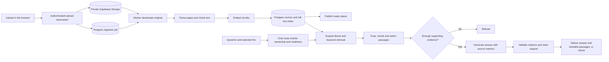

# QueryVault

QueryVault lets you ask a question across selected documents and open the passage that supports an answer. The mini-project demonstration follows two guides for one fictional event, plus a third event with a conflicting time. The presenter can show why selecting sources matters and what happens when none of them contains the answer.

**Start here:** [six-minute walkthrough and expected evidence](docs/DEMO.md) · [three demo documents](demo/documents/) · [test coverage](docs/TESTING.md).

## Run the browser rehearsal

From the repository root, use Node 22+, npm and an installed Playwright Chromium browser or Google Chrome. Bun is also required for the offline evaluation gate. Install project dependencies with `npm ci` on a fresh checkout.

```sh
npm run demo:rehearse
npm run demo:rehearse -- --headed --debug
```

The command builds a local verification bundle, starts the compiled app on loopback port 5197, runs three browser scenarios, then stops the server. Port 5197 must be free. The second command opens Playwright Inspector so you can step through actions during a presentation. The rehearsal uses fictional sessions, HTTP fixtures for storage/database/chat, and scripted answers. It needs no Supabase or AI credentials. Windows installations of Chrome in the standard Program Files directory are selected automatically. Set `QV_BROWSER_CHANNEL=chrome` to select an installed Chrome on another platform, or install the Playwright Chromium matching the project. The bundle in `.output` contains fixture configuration and is for local verification only.

## Architecture



## Run with real local services

Use a dedicated checkout, a disposable Supabase project with the repository migrations and private documents bucket, and a compatible **local** model service. The embedding model must return 3072 dimensions. The app also needs chat and utility models for generation and support verification. The prepared local profile disables AI requests, so it can demonstrate account and library operations only. Bring up local Supabase using the [isolated setup instructions](docs/PHASE6_LOCAL_READINESS.md).

Once the disposable stack is healthy, copy `config/zero-cost.env.example` to the ignored `.env.zero-cost.local` if that file does not already exist. Enter the stack's actual loopback URL, project ID, publishable and service-role keys, and a fresh worker secret. Start the local app:

```sh
npm run dev:zero-cost
```

Sign in at `http://127.0.0.1:5173/chat`. Full ingestion additionally requires the worker and a validated local inference configuration. The loopback-only profile deliberately blocks AI calls, including embeddings. QueryVault has an OpenAI-compatible provider interface with chat, utility and 3072-dimensional embedding settings, but an inference-enabled local profile still needs integration and acceptance on this machine. Simply supplying a model key to `dev:zero-cost` does not enable it. The [environment example](.env.example) documents server-only settings. Use the browser rehearsal for the showcase until the full service path has passed.

## Verification and limits

- The rehearsal exercises the real browser interface, including upload progress, document selection, citation navigation and failures. Storage, chat responses and persistence in those browser cases use fixtures.
- The unit/integration suite separately exercises production parsing, chunking, worker transitions, retrieval and chat validation. The offline evaluation gate uses a fixed synthetic corpus. These checks have different boundaries from a live upload-to-answer run.
- Text extraction can lose diagram content or table layout. Missing evidence can produce a refusal. A service failure should be presented as a failure.
- A real local run with Postgres, embeddings and generated answers remains a separate acceptance check. The formal reviewed benchmark is future work.

Run `npm test -- --configLoader native`, `npm run typecheck`, `npm run lint`, and `npm run eval:gate` for project checks. See [deployment](docs/DEPLOYMENT.md) for operational details.

QueryVault is a mini-project by **Darsh Soam**, distributed under the [MIT license](LICENSE).
